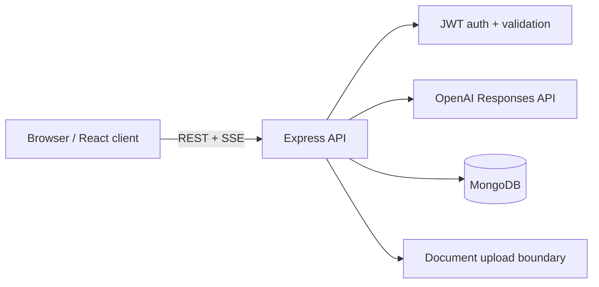

<div align="center">


<p><strong>A production-oriented ChatGPT-style assistant for thoughtful conversations, document-aware workflows, and a clean developer experience.</strong></p>

<p>
  <a href="#-features">Features</a> ·
  <a href="#-quick-start">Quick start</a> ·
  <a href="#-architecture">Architecture</a> ·
  <a href="#-contributing">Contributing</a>
</p>


</div>

<br />

## ✨ Features

- **Streaming conversations** — receive model responses in real time through Server-Sent Events.
- **Secure authentication** — short-lived access tokens, refresh-token rotation, password hashing, and owner-scoped data access.
- **Document workflows** — upload and manage document metadata through an isolated API boundary.
- **Typed full stack** — shared TypeScript-first tooling across the React client and Express API.
- **Production-minded API** — request validation with Zod, security headers with Helmet, CORS, and rate limiting.
- **Testable by default** — Vitest, React Testing Library, and Supertest coverage hooks.

## 🧰 Tech stack

| Layer | Technologies |
| --- | --- |
| Client | React, Vite, TypeScript, React Router, TanStack Query, Lucide |
| API | Express, TypeScript, Zod, JWT, bcryptjs, Multer |
| Data | MongoDB with Mongoose |
| AI | OpenAI Responses API |
| Quality | Vitest, React Testing Library, Supertest |

## 🚀 Quick start

### Prerequisites

- Node.js **20 or newer**
- MongoDB locally or through MongoDB Atlas
- An OpenAI API key

### Installation

```bash
git clone https://github.com/Aayush-coder32/codestrom.git
cd codestrom
npm install
```

Create `server/.env`:

```env
MONGODB_URI=mongodb://127.0.0.1:27017/nexus-ai
JWT_ACCESS_SECRET=replace-with-a-long-random-secret
JWT_REFRESH_SECRET=replace-with-another-long-random-secret
OPENAI_API_KEY=your-openai-api-key
```

Create `client/.env`:

```env
VITE_API_BASE_URL=http://localhost:5000/api
```

Start both applications:

```bash
npm run dev
```

| Service | URL |
| --- | --- |
| Client | `http://localhost:5173` |
| API | `http://localhost:5000` |

> **Security note:** Never commit `.env` files, API keys, JWT secrets, or production credentials.

## 📜 Available commands

```bash
npm run dev         # Start client and API in development mode
npm run build       # Build both workspaces
npm run type-check  # Type-check client and API
npm test            # Run client and API test suites
```

## 🏗️ Architecture



The client owns presentation and keeps the short-lived access token in memory. The API owns authentication, authorization, model calls, uploads, and persistence. Conversation and document queries are scoped to the authenticated owner.

Chat streaming uses a newline-delimited SSE protocol:

- `message_start` — conversation context
- `content_delta` — streamed text fragment
- `message_complete` — final response
- `error` — request failure

More detail is available in [docs/ARCHITECTURE.md](docs/ARCHITECTURE.md), [docs/API.md](docs/API.md), and [docs/DEPLOYMENT.md](docs/DEPLOYMENT.md).

## 🤝 Contributing

Contributions, bug reports, and thoughtful product ideas are welcome.

1. Fork the repository and create a focused branch:
   ```bash
   git checkout -b feat/your-improvement
   ```
2. Install dependencies with `npm install`.
3. Keep changes scoped and follow the existing TypeScript patterns.
4. Run checks before opening a pull request:
   ```bash
   npm run type-check
   npm test
   npm run build
   ```
5. Open a pull request with a clear summary, screenshots for UI changes, and test evidence.

Please do not include secrets, private data, generated build output, or unrelated formatting changes in a pull request.

## 📄 Copyright & usage

Copyright © 2026 **Aayush-coder32**. All rights reserved.

Unless a separate license file or written permission states otherwise, the source code, design, branding, and documentation in this repository may not be copied, redistributed, or used to create a competing product. Third-party libraries remain subject to their own licenses.

## 🙌 Acknowledgements

Built with React, Express, MongoDB, and the OpenAI API. The project is designed to evolve through transparent engineering, community feedback, and responsible AI usage.
